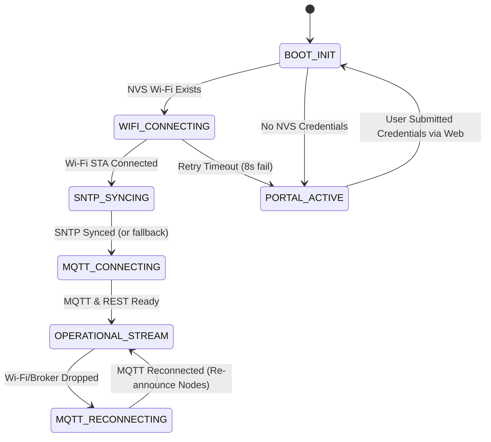

# SYSTEM SPECIFICATION: WEARABLE IOT DUAL-CHIP GATEWAY

> **Document ID:** `SPEC-GATEWAY-2026`  
> **Status:** APPROVED / IN-PROGRESS  
> **Target Subsystems:** nRF52840 BLE Central Bridge + ESP32-S3 Cloud Gateway  
> **Upstream Platform:** ThingsBoard IoT Gateway (`mqtt://103.116.39.179:1883`, REST HTTPS `https://c7.hust-2slab.org`)  
> **Downstream Dashboard:** Next.js 14 Web Dashboard (`wearable-server.vercel.app`)  
> **Peripheral Nodes:** Multi-node Wearable Vital Monitors (`ECG_dev_XX`, AD8232, MAX30102, MMA8452Q, TMP117)

---

## 1. Objective & Scope (Mục Tiêu & Phạm Vi Hệ Thống)

### 1.1. Problem Statement
Hệ thống giám sát bệnh nhân đeo tay yêu cầu thu thập đồng thời từ tối đa 10 Node cảm biến:
1. Tín hiệu điện tâm đồ thời gian thực (ECG $250\text{ Hz}$, $4\text{ ms/sample}$).
2. Dữ liệu sinh hiệu hợp nhất (PPG Heart Rate, ECG Heart Rate, $\text{SpO}_2$, Nhiệt độ da $0.1^\circ\text{C}$).
3. Trạng thái kết nối (Online / Offline) phản ánh chính xác lên Web Dashboard theo thời gian thực mà không bị gián đoạn hay kẹt bộ đệm.

Một chip đơn lẻ không thể vừa duy trì kết nối BLE đa kết nối tần số cao (10 kết nối đồng thời với chu kỳ kết nối ngắn), vừa gánh stack Wi-Fi WPA2/WPA3, TLS/HTTPS, MQTT, JSON serialization và Captive Portal mà không làm trễ thời gian lấy mẫu ECG.

### 1.2. Architecture Solution: Dual-MCU Heterogeneous Gateway
Giải pháp phân tách phần cứng chuyên biệt (Asymmetric Multi-Processing / Multi-Chip):
- **MCU 1 (Radio Gateway / BLE Central):** Nordic **nRF52840** chạy Zephyr RTOS. Đảm nhiệm quét (Scan), kết nối (Connect lên đến 10 Node), đăng ký GATT Notification và đẩy dữ liệu thô sang UART với độ trễ tối thiểu.
- **MCU 2 (Network & Cloud Gateway):** Espressif **ESP32-S3** (Dual-Core LX7 @ 240MHz, 8MB PSRAM, 16MB Flash) chạy ESP-IDF FreeRTOS. Đảm nhiệm phân tích khung UART, đồng bộ thời gian thực SNTP, đóng gói JSON chuẩn ThingsBoard Gateway Protocol theo địa chỉ MAC-native, đẩy dữ liệu qua MQTT, và hỗ trợ quản trị Wi-Fi Captive Portal.

---

## 2. Capability Map & Module Breakdown

```
┌─────────────────────────────────────────────────────────────────────────────────┐
│                           CAPABILITY MAP: GATEWAY SUBSYSTEM                     │
├────────────────────┬──────────────────────────────────────────┬─────────────────┤
│ Module ID          │ Responsibility                           │ Depends On      │
├────────────────────┼──────────────────────────────────────────┼─────────────────┤
│ ble-central        │ Quét, ghép nối, nhận GATT Notify 10 Node │ nRF52840 Zephyr │
│ uart-bridge-proto  │ Đóng gói khung nhị phân, CRC-8, 460.8kbps│ ble-central     │
│ esp32-ingest-pipe  │ Core 1 UART RX, DMA/FIFO, Queue FSM      │ uart-bridge-proto│
│ esp32-cloud-sync   │ Core 0 Wi-Fi, SNTP, TB MQTT & REST Sync  │ esp32-ingest-pipe│
│ esp32-portal-nvs   │ Captive Portal AP, Lưu credentials NVS   │ ESP-IDF NVS     │
└────────────────────┴──────────────────────────────────────────┴─────────────────┘
Build & Dependency Order:
  uart-bridge-proto ──▶ ble-central ──▶ esp32-ingest-pipe ──▶ esp32-cloud-sync ──▶ esp32-portal-nvs
```

---

## 3. Hardware-Software Contract & Pinout

### 3.1. Inter-Chip Physical Bus (Hợp đồng kết nối vật lý)
| Tín hiệu | nRF52840 Pin | ESP32-S3 Pin | Đặc tính điện | Ghi chú |
|---|---|---|---|---|
| **UART TX (nRF $\to$ ESP)** | `P0.17` / `TXD` | `GPIO 18` / `U1RXD` | 3.3V LVTTL | 460800 Baud, 8-N-1 |
| **UART RX (ESP $\to$ nRF)** | `P0.20` / `RXD` | `GPIO 17` / `U1TXD` | 3.3V LVTTL | Lệnh Downlink cấu hình |
| **GND** | `GND` | `GND` | Common Ground | Bắt buộc chung mass |
| **Hardware Reset** | N/A (hoặc GPIO) | N/A | Active-Low | Khởi động độc lập |

### 3.2. Băng thông & Ngân sách Bus UART ($460800\text{ Baud}$)
- **Tốc độ truyền lý thuyết:** $460800\text{ bps} \div 10 = 46.08\text{ KB/s}$.
- **Tải trọng cực đại (Worst-Case Load) với 10 Node hoạt động đồng thời:**
  - 10 Node $\times$ ECG ($250\text{ Hz} \times 2\text{ bytes} = 500\text{ B/s}$) = $5000\text{ B/s}$.
  - Đóng gói mẻ 50 mẫu ($100\text{ B} + 5\text{ B overhead} = 105\text{ B}$ mỗi $200\text{ ms}$ cho mỗi Node) = $525\text{ B/s/Node} \times 10 = 5250\text{ B/s}$.
  - Vitals ($10\text{ B}$ mỗi $1\text{ s/Node}$) = $100\text{ B/s}$.
  - **Tổng lưu lượng:** $\approx 5.35\text{ KB/s}$.
  - **Tỷ lệ sử dụng bus:** $5.35\text{ KB/s} \div 46.08\text{ KB/s} \approx 11.6\%$.
  - $\Rightarrow$ **Hệ số an toàn băng thông (Headroom):** $>8.6\times$, đảm bảo không bao giờ nghẽn bus hoặc tràn FIFO vật lý.

---

## 4. Giao Thức Truyền Thông Chi Tiết (Communication Protocols)

### 4.1. Tầng BLE GATT (Node $\longleftrightarrow$ nRF52840 Central)
- **Service UUID:** `0x1400` (`6E401400-B5A3-F393-E0A9-E50E24DCCA9E`)
- **TX Characteristic (Notify):** `0x1401`
  - Vitals Packet ($5\text{ bytes}$): `[hr_ecg (1B)][hr_ppg (1B)][spo2 (1B)][temp_x10 (2B LE)]`
  - ECG Batch Packet ($100\text{ bytes}$): 50 mẫu `int16_t` Little-Endian ($200\text{ ms}$ dữ liệu tại $250\text{ Hz}$).
- **RX Characteristic (Write Without Response):** `0x1402`
  - Nhận lệnh cấu hình tham số từ Gateway (`CMD_ECG_CFG`, `CMD_THR`, `CMD_MODE_CFG`).

### 4.2. Tầng UART Bridge (nRF52840 $\longleftrightarrow$ ESP32-S3)
Khung truyền nhị phân có kiểm tra tính toàn vẹn CRC-8:
```
┌──────┬─────────┬──────────┬────────┬─────────────────────────────┬──────┐
│ SOF  │ NODE_ID │ PKT_TYPE │ LENGTH │           PAYLOAD           │ CRC8 │
│ 0xAA │  0..9   │ (1 Byte) │ 1..128 │         (N Bytes)           │ (1B) │
└──────┴─────────┴──────────┴────────┴─────────────────────────────┴──────┘
```
- **SOF:** `0xAA`
- **PKT_TYPE:**
  - `0x01` (`UART_PKT_TYPE_ECG_BATCH`): 100 bytes (50 mẫu int16).
  - `0x02` (`UART_PKT_TYPE_VITALS`): 5 bytes struct sinh hiệu.
  - `0x03` (`UART_PKT_TYPE_NODE_STATUS`): 1 byte (`0x01`: Connected, `0x00`: Disconnected).
  - `0x80` (`UART_PKT_TYPE_DOWNLINK`): Lệnh từ Cloud gửi ngược về Node.
- **CRC-8:** Đa thức $x^8 + x^2 + x + 1$ (`0x07`), tính trên `[NODE_ID ... PAYLOAD[LEN-1]]`.

### 4.3. Tầng Cloud: ThingsBoard Gateway MQTT Protocol
- **Broker:** `mqtt://103.116.39.179:1883`, Client Access Token Gateway.
- **1. Thiết bị kết nối (`v1/gateway/connect`):**
  - Payload: `{"device": "Node1"}` (Tương ứng Node ID $0 \to$ `Node1`, $1 \to$ `Node2`,...).
- **2. Thiết bị ngắt kết nối (`v1/gateway/disconnect`):**
  - Payload: `{"device": "Node1"}`
- **3. Dữ liệu chuỗi thời gian (`v1/gateway/telemetry`):**
  ```json
  {
    "Node1": [
      {
        "ts": 1712839200000,
        "values": {
          "ppgHeartRate": 75,
          "ecgHeartRate": 74,
          "spo2": 98,
          "temperature": 36.8
        }
      }
    ]
  }
  ```
  *(Trường `ts` sử dụng Unix Epoch thời gian thực từ SNTP. Nếu chưa đồng bộ SNTP, Gateway hoãn publish hoặc báo lỗi `-2`, không bao giờ gửi timestamp năm 1970).*

### 4.4. Tầng Cloud: MAC-Native MQTT Gateway & Passive Freshness Window
- **Định danh MAC-Native:** Thiết bị được định danh bằng địa chỉ MAC phần cứng (`XX:XX:XX:XX:XX:XX`) trong toàn bộ topic Gateway (`v1/gateway/connect`, `v1/gateway/telemetry`, `v1/gateway/attributes`, `v1/gateway/disconnect`).
- **Passive Freshness Window (5,000 ms):** Web Dashboard và backend API đánh giá trạng thái online/offline của từng stream dữ liệu dựa trên sliding window 5,000 ms (`serverNow - observedAt <= 5000 ms`). Module REST Client (`tb_rest_client.c`) và việc ghi `SERVER_SCOPE.connected` đã được loại bỏ hoàn toàn, giúp thu hồi 28KB SRAM và triệt tiêu 2–8 giây độ trễ HTTPS TLS.

---

## 5. Kiến Trúc Bộ Nhớ, Phân Bổ Core & Quản Lý Tác Vụ (Execution & Memory Budget)

### 5.1. Phân Bổ Core Trên ESP32-S3 (Dual-Core LX7)
```
┌────────────────────────────────────────────────────────────────────────┐
│                        CORE 0 (PRO_CPU)                                │
│  - Wi-Fi STA / SoftAP Driver & Event Loop                              │
│  - SNTP Time Synchronization Service                                   │
│  - cloud_consumer_task (Priority 5, Stack 4096B)                       │
│      * Rút frame từ s_snapshot_queue, serialize JSON, publish MQTT      │
├────────────────────────────────────────────────────────────────────────┤
│                        CORE 1 (APP_CPU)                                │
│  - sensor_producer_task (Priority 10, Stack 4096B)                     │
│      * Polling UART DMA/FIFO tốc độ cao 460800 baud                    │
│      * Parser FSM + CRC-8, binding Core 1 gate session table           │
│      * Đẩy tuple copy-by-value vào s_snapshot_queue (64 frames)        │
└────────────────────────────────────────────────────────────────────────┘
```
└────────────────────────────────────────────────────────────────────────┘
```

### 5.2. Chính Sách Bộ Nhớ (Zero Dynamic Allocation Post-Boot)
1. **Tuyệt đối không cấp phát động (`malloc`/`free`)** trong chu kỳ thu thập dữ liệu thời gian thực.
2. Các bộ đệm chuyển đổi chuỗi JSON (`s_synth_tx_buf[2048]`, `rx_buf[4096]`) được cấp phát tĩnh trong `.bss`.
3. Khởi tạo `s_frame_queue = xQueueCreate(64, sizeof(uart_rx_frame_t))` cố định 1 lần duy nhất khi boot.
4. Dung lượng phân vùng Flash: Cấu hình `CONFIG_PARTITION_TABLE_SINGLE_APP_LARGE=y` (2 MB Flash APP partition), đảm bảo tối thiểu $30\%$ dung lượng trống phục vụ mở rộng.

---

## 6. Máy Trạng Thái Hệ Thống & Cơ Chế Fail-Safe (FSM & Reliability)

### 6.1. Ma trận Trạng thái Gateway


### 6.2. Các Kịch Bản Khôi Phục Sự Cố (Failure Modes & Mitigations)
1. **Mất kết nối Wi-Fi:**
   - Wi-Fi event handler tự động reconnect cấp số nhân.
   - Core 1 vẫn tiếp tục đọc UART và duy trì queue (drop có kiểm soát nếu đầy, không treo task).
2. **Mất kết nối MQTT Broker:**
   - `tb_mqtt_reconnect()` ngầm thực thi.
   - Khi MQTT kết nối lại thành công (`on_mqtt_connected`): Xóa bảng cờ `s_node_announced`, kích hoạt lại `v1/gateway/connect` cho tất cả các Node đang active.
3. **Mất nguồn / Node BLE ngắt kết nối đột ngột:**
   - Central nRF52840 phát hiện ngắt kết nối qua BLE supervision timeout.
   - Gửi ngay gói tin `UART_PKT_TYPE_NODE_STATUS` (`status = 0`) sang ESP32.
   - ESP32 phát lệnh `v1/gateway/disconnect` lên MQTT; Web Dashboard tự động chuyển sang `OFFLINE` khi hết 5,000 ms Freshness Window.

---

## 7. Các Lệnh Build, Flash & Kiểm Thử (Commands)

### 7.1. Biên dịch & Nạp ESP32-S3 Cloud Gateway
```powershell
# Chuyển vào thư mục esp32_cloud
cd "gateway/esp32_cloud"

# Cấu hình & build firmware
idf.py set-target esp32s3
idf.py build

# Nạp qua cổng COM (ví dụ COM8)
idf.py -p COM8 flash monitor
```

### 7.2. Biên dịch & Nạp nRF52840 Central Bridge (Zephyr / NCS)
```powershell
cd "gateway/nrf_central"
west build -b promicro_nrf52840 -d build/nrf_central --pristine
west flash
```

### 7.3. Chạy Unit Test Cục Bộ Trên Máy Tính (Host TDD)
```powershell
cd "gateway/esp32_cloud"
gcc -Wall -Wextra -I./main -I../common main/data_synthesizer.c tests/test_data_synthesizer.c -o test_runner.exe
./test_runner.exe
```

---

## 8. Ranh Giới Phát Triển (Architectural Boundaries)

- **LUÔN LUÔN (Always):**
  - Giữ Core 1 chuyên biệt cho UART Parsing; không thực hiện bất kỳ hoạt động mạng hay I/O chặn (blocking network calls) trên Core 1.
  - Sử dụng buffer tĩnh và snprintf an toàn cho mọi thao tác JSON.
  - Kiểm tra CRC-8 cho mọi gói tin trước khi cho vào hàng đợi xử lý.
- **HỎI TRƯỚC (Ask First):**
  - Thay đổi định dạng gói tin nhị phân trong `uart_frame_def.h` hoặc `ble_protocol_def.h`.
  - Thay đổi địa chỉ broker hoặc account xác thực ThingsBoard.
  - Mở rộng số lượng Node vượt quá 10.
- **TUYỆT ĐỐI KHÔNG (Never):**
  - Không gọi `malloc()` / `free()` trong vòng lặp thời gian thực của producer hoặc consumer.
  - Không chặn luồng UART khi MQTT mất kết nối.
  - Không gửi các giá trị timestamp chưa đồng bộ (epoch 1970) lên ThingsBoard.

---

## 9. Tiêu Chí Nghiệm Thu (Success Criteria)

1. **Hiển thị LIVE trên Web:** Khi Node được bật và kết nối tới Central, biểu tượng thẻ thiết bị trên Web Dashboard hiển thị `LIVE` trong vòng $< 3\text{ giây}$.
2. **Hiển thị OFFLINE chính xác:** Khi Node tắt hoặc ngắt kết nối BLE, thẻ thiết bị chuyển `OFFLINE` và các giá trị sinh hiệu chuyển sang `--`.
3. **Độ trễ dòng sóng ECG:** Dữ liệu ECG $250\text{ Hz}$ hiển thị mượt mà trên biểu đồ sóng với độ trễ không vượt quá $500\text{ ms}$.
4. **Không tràn hàng đợi:** Trong bài kiểm tra tải 10 Node gửi liên tục trong 1 giờ, số lượng gói tin bị rơi (`Queue dropped`) bằng 0 khi mạng Wi-Fi ổn định.
5. **Khôi phục mạng tự động:** Khi rút router Wi-Fi và cắm lại sau 1 phút, Gateway tự động kết nối lại và khôi phục truyền dữ liệu bình thường mà không cần reset phần cứng.
